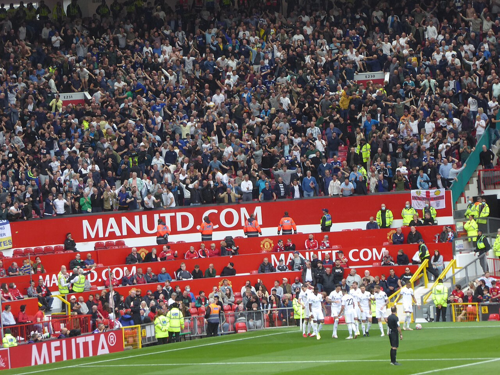

今晚玫瑰德比，埃兰路，1-1。联赛七轮踢完，7分，1胜4平2负，唯一的胜利还是八月底的事。这个开局追平了1989-90赛季——弗格森时代最凶险的一个秋天。玫瑰德比今天反而是支线，主线是，卡里克的帅位已经岌岌可危了。

利兹控球61%，我们主动让出球权打转换。35分钟，蒂勒曼斯起球传中，姆伯莫中路左脚推射入网，0-1，这球传的水平很高，不停球绕过了前点的中卫。下半场刚回来6分钟，利兹角球，前点穆哈雷莫维奇一摆，卡尔弗特-勒温中路右脚打进，1-1。之后两边都没能再改写比分：我们13脚射门3脚射正、6脚被封堵，xG只有0.63；利兹12射5正，xG 0.60。一场谁也没真正创造出绝对机会的比赛，各拿一分，都可以接受也都不太服气。

丢球倒是很曼联，而且是很熟悉的剧本：下半场刚回来6分钟就丢，标准的定位球丢分，前点一摆、后点包抄，防角球的布置又是一团糟。这赛季领先被追平也不是第一次了，埃弗顿、联赛杯的布莱顿、加上今天，比赛管理这件事，卡里克接手大半年了还是老样子。射门质量同样是问题：13脚听着不少，但6脚被封堵、只有3脚射正，xG 0.63，全是外围硬起脚的球——对手对你的研究已经很透了，利兹全场16次犯规，大半是拦我们转换起速的犯规，B费第17分钟就因为回抢犯规吃了黄牌。倒是巴莱巴伤愈复出直接进了首发，和桑托斯一起保护中场，蒂勒曼斯位置顶得靠前，姆伯莫那球就是他送的传中。人齐了，账还是没赢下来。

蒂莱曼斯面临着很多球迷的批评，但其实我觉得他的表现其实一直是不错且稳定的。B费今年状态低迷，蒂莱曼斯在后腰位置上其实是承担了很多额外的压力的，尤其是他本身并非防守型球员。在维拉，爱美丽给他排了两个打手保驾护航。我相信现在有了巴莱巴之后，他会有更好的表现。倒是B费，必须要改变了。他本来的踢法就是跟对面互爆的，通过大量的冒险传球换取更多的进攻机会，但也有失去球权的风险。现在只剩下风险了，队友压力太大了。国际比赛伤了很多人，现在左后卫右后卫都是客串的，防线不稳可以理解。但现在的进攻实在是太差了。卡里克能有魄力，让B费下来，让齐尔克泽、芒特多试试吗？

利兹回英超一年多，这组对手我们三场没赢：一月埃兰路1-1，阿伦森先进，库尼亚扳平——那是阿莫林带的最后一场，第二天他就下课了；四月利兹来老特拉福德，奥卡福上半场进了两个，1-2，白玫瑰把比赛带走了；加上今晚，两平一负。我印象最深的玫瑰德比还是20年12月的6-2和21年揭幕战的5-1，B费帽子戏法，博格巴刷了四个助攻，那时候没人想得到有一天利兹会在老特拉福德赢球。23年2月一平一胜之后他们降级了，等再回来，故事就不一样了。

回到主线。七轮7分的问题在哪，其实和上个月写的差不多，只是更多了：阵地战近不了球（10人曼城、富勒姆），客场让出球权打转换，转换又踢不出质量（今天）；领先守不住（埃弗顿、联赛杯的布莱顿、今天）；防守定位球的老毛病照旧。联赛上一场胜利已经是一个多月前的事了。球员不能说不拼，但对手摸透了这套东西，卡里克到现在没给出新的答案。

赛后照例是一片喊卡里克下课的声音。我的态度上个月写过：先让他踢到圣诞。七轮7分之后，这个立场比一个月前难坚持多了。但我还是这个想法。自从弗格森退休后，我们已经尝试了英超中游的实力主帅、成名已久的顶级名帅、小联赛制霸的青年主帅、各种DNA主帅。不好使，没一个好使。我知道卡里克下课也合理，他看起来也是束手无策，每场比赛的排兵布阵都让人有些疑惑，换人也不及时。但是，这种情况换人，我觉得还是咪一鸠样。接下来两场联赛，主场伯恩茅斯，中间还夹着一场欧冠，面对这两年非常强势的少帅小法。要是下一场联赛还拿不下，圣诞这个期限恐怕就得往前挪了。

曼联从成绩上退出一流已经很多年了，现在看起来二流都很难保住。当年弗格森退休的时候，我的期待是曼联能让弗格森再见证一次英超冠军，甚至欧冠冠军。现在，我只希望我能再见证一次。

<small>图源：[Ardfern / Wikimedia Commons](https://commons.wikimedia.org/wiki/File:Manchester_United_v_Leeds_United,_14_August_2021_%2812%29.jpg)，CC BY-SA 4.0</small>
