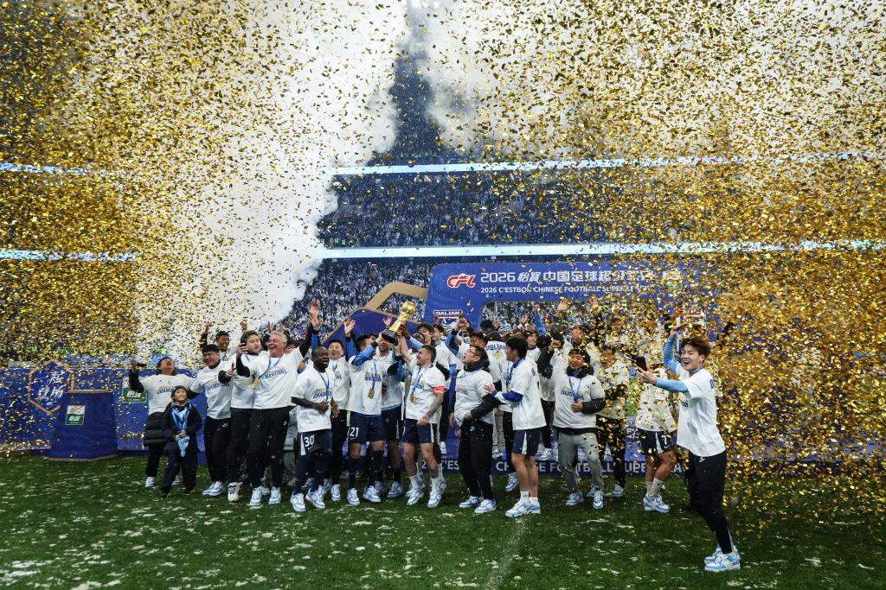

真是疯狂的一天。

9:00，Gen.G 3:0 轻取 IG，涅槃起飞的故事就此终结。

17:00，山东 3:2 成都，大连 3:1 天津，大连在最后 5 轮抹平了 14 分的巨大差距，获得了中超冠军。

26:30，曼联 4:4 维拉，上下半场分别开局被闪击两球，又分别扳平。

第一场赛后，TheShy 选手接受了采访，表达了支持 Chovy 选手夺冠的意思。支持谁当然是他的权利，Chovy 选手也无疑是常年位居战力榜前列的顶级选手。然而这一表述无疑是不理智的，考虑到他职业生涯一直效力于 LPL 赛区，支持其他赛区选手的做法，至少对商业价值是有害的。

我并非 TheShy 选手的粉丝，相反我其实不太喜欢他。明明坐拥顶级天赋却总是乱玩。但我又的确很喜欢看他比赛，毕竟他的比赛，无论黑子白子串子都可以很满意。IG 这支队我可能只对 Rookie 选手有一些欣赏。可惜 Rookie 职业生涯规划稀烂，又喜欢跟 TheShy 打兄弟 LOL，那不容易出成绩也是理所当然的了。

下午的中超无疑是疯狂的。我不看中超，但一两个月前，我就开始听到各种成都再赢一场、再平一场就夺冠的消息了。没想到啊没想到，5 轮 14 分的巨大差距，居然真的被一点点抹平了。这是我看球以来所听过见过的最大的逆转，离谱至极。

14 分，剩下 5 场，我算了一下，这意味着你就算最后五场全赢，对面只要拿两分，你也没办法。成都甚至不需要赢球，五场里面多平一场，冠军都是自己的。我们平时总说把命运掌握在自己手里，这已经不是掌握了，这是奖杯都快递到家门口了，最后愣是没签收。

晚上的小众变态比赛更是不提了。可怜我曼联怎么说也是大英头牌之一，居然沦落至此。按照目前的平均得分，到赛季结束总分将不到 31 分，而英超成功保级的最低积分纪录是 32 分。弗格森退休时，我曾希望曼联能在弗格森有生之年为他再献上一座英超冠军奖杯。现在，我只希望我能活着见证曼联下一次英超夺冠。

这三场给我的感觉完全不一样。IG 输给 Gen.G，不甘心归不甘心，但也知道实力差距摆在那里。大连这个冠军，是看完了结果还得再去确认一下积分榜，生怕自己看错。曼联倒好，过程够疯狂，结果却一点不意外。凌晨看完，还是熟悉的配方。

<small>图源：[新华网](https://www.xinhuanet.com/20261109/92db7a10ada54656b4f374ea9270a44f/c.html)，摄影：新华社记者潘昱龙</small>
