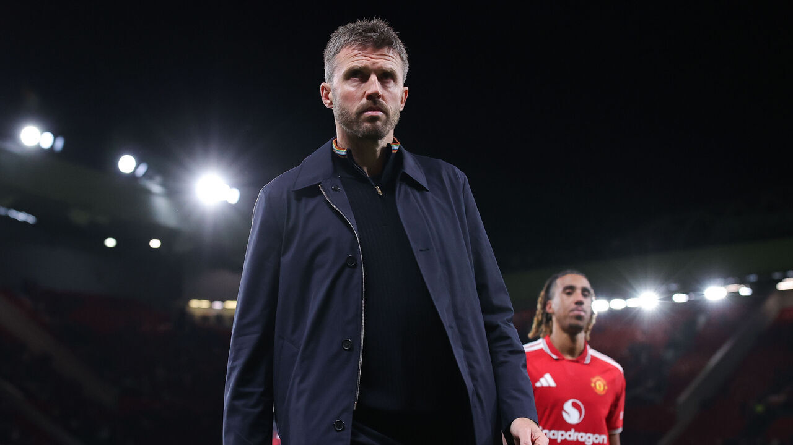

就在前几天，曼联和维拉打了一场小众变态比赛。先是开场不到 4 分钟连丢两球，好不容易半场追回来，场面也不错，本来以为又是像周中打罗马一样来一场荡气回肠的大逆转。结果下半场一开局又是 8 分钟丢两球，然后补时连追两球，最后达成 4-4 平。

这两天，各种各样的传闻开始出现了。DO 等记者报道称曼联计划解雇卡里克，不过俱乐部的口径仍是尚未作出决定。可能的新帅人选包括波切蒂诺、埃迪·豪、纳格尔斯曼等。

上个月我还说，至少让他踢到圣诞。现在离圣诞还有一个多月，我也很难继续坚持了。不是因为又平了一场维拉，而是踢到现在，输球的方式没变，连抢回一分都得靠这种比赛。周中逆转罗马当然看得很爽，但总不能每场都先送两个，再指望最后十分钟救命。真有稳定解决问题的办法，也不至于场场都要靠意志品质。

没想到当年索尔斯克亚下课的时候说的话又可以拿来用一次了。

> 有段日子没发内容了…没想到是因为这个。我抬今天官宣了索尔斯克亚下课。倒没什么可以惋惜的——下课纯属理所应当，咎由自取。尽管我个人认为索尔斯克亚近期糟糕的战绩可以理解，制服组才是我抬这几年混乱的罪魁祸首，但在任何一家俱乐部，这样的战绩都是要下课的，哪怕你是名宿。
>
> 伟大如克洛普之于多特蒙德，拉涅利之于莱斯特城，迪马特奥之于切尔西，战绩不好也只能下课。即使我们都知道临时顶替的卡里克、弗莱彻做主帅的能力很可能更菜，但不换只有继续沉沦的份，整个队心态都崩了，只有换帅才可能重新开始。

——[《江湖再见，索尔斯克亚》](/posts/solskjaer-sacked-21/)，2021 年 11 月

目前在曼联负责足球业务的贝拉达和威尔考克斯是拉爵爱将，解雇是不可能解雇的，那只能苦一苦主教练，让卡里克出来背锅了。我知道卡里克下课也没啥冤枉的，但换主教练除了浪费钱之外毫无作用，只能找来下一位咪一鸠样。

我现在最想知道的，反而是贝拉达和威尔考克斯准备怎么解释这次换帅。五月觉得他能带队，给了正式合同，到了十一月又觉得不行了，那当时看中的到底是什么？如果只是春天那一段成绩好，现在成绩差就换，那这个足球管理层也太好当了。主教练当然要为场上的东西负责，但选他、给他配人、决定球队往哪个方向走的人，总不能每次都像跟这件事没关系一样。

自从格雷泽家族杠杆收购曼联以来，就一直变着法子从曼联拿钱。隔壁俱乐部因为被指将股东资金伪装成赞助收入而遭到指控，曼联老板一看：这他妈不是傻子嘛。得亏曼联家大业大，长期一直是世界足球俱乐部中营收数一数二的，才在竞技层面没有崩盘。然而这一天终究是要到来了。现在曼联阵中恐怕找不出一名能在曼城、阿森纳踢首发的球员，能踢替补的都不多。

我理解王权没有永恒，弗格森退休后曼联肯定要经历长时间的低迷。不过我当时以为的低迷是欧冠资格竞争者这种低迷，可不是保级这种啊。

<small>图源：[theScore](https://www.thescore.com/epl/news/3630791/report-man-utd-plan-to-sack-carrick-pochettino-favored-as-replacement)，摄影：James Gill - Danehouse / Getty Images</small>
